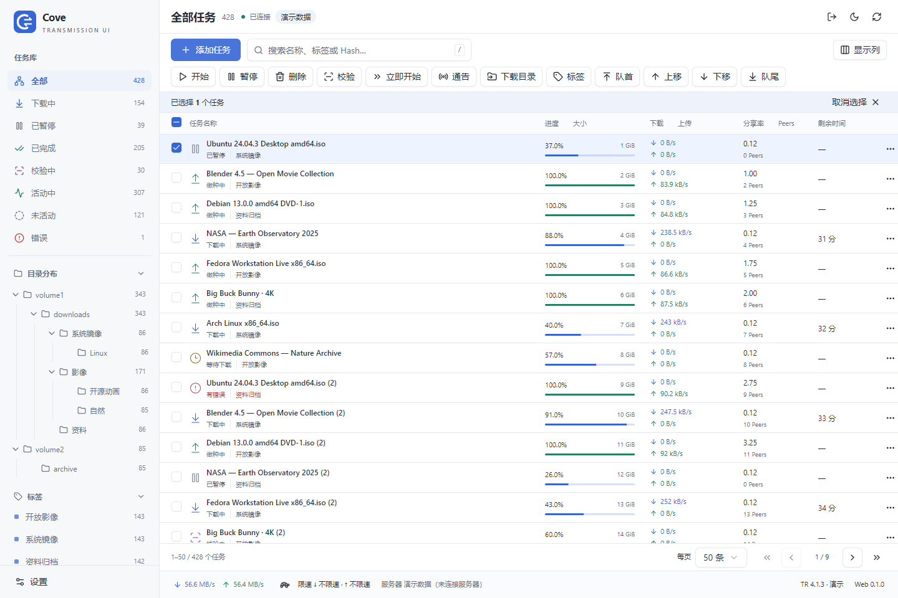

<div align="center">


# Transmission Cove

**A modern web workspace for Transmission.**

Keep downloads, seeding, and hundreds of tasks organized.

</div>

<!-- README-I18N:START -->

[简体中文](./README.md) | **English**

<!-- README-I18N:END -->

[Features](#features) · [Quick start](#quick-start) · [Configuration](#configuration) · [Documentation](#documentation) · [Development](#development)



Transmission Cove (**Cove** for short) is a third-party web interface for Transmission 4.0+, styled with shadcn/ui. Replace the native web interface or deploy it independently with Docker to manage a large torrent collection on your NAS from your desktop.

**Keep your existing Transmission instance, download directories, and tasks. No data migration or re-adding torrents required.** This project is not affiliated with the Transmission project.

<a id="features"></a>
## Features

- **One instance, ready to connect** — Detects the native RPC path automatically; Docker connects to Transmission on the same host by default. Existing RPC authentication stays in place.
- **Built for large collections** — Virtualized lists, search and sorting, batch actions across pages, and pagination with presets, custom sizes, or all tasks.
- **Find what matters** — Eight task states, nested download directories, labels, and Tracker filters. Collapsed groups still show active filters.
- **Everyday torrent management** — Add Torrent files, magnet links, and URLs, including drag-and-drop and batch imports; start, pause, verify, reorder, reannounce, and confirm deletion.
- **Detailed control** — File selection and priorities, renaming, download paths, Tracker editing, Peers, speed limits, and seeding rules. Global settings reflect daemon capabilities.
- **Compact and readable** — Resizable sidebar and columns, combined metrics, colored status icons, transfer statistics, light and dark themes, and mobile layouts.

Connects to one server at a time, automatically by default, with a hidden manual switch. The application interface is in Simplified Chinese. RSS, automated download rules, long-term history charts, and torrent creation are outside the current scope.

<a id="quick-start"></a>
## Quick start

You need a running **Transmission 4.0+** instance with RPC access enabled. Choose a deployment method:

| Method | Best for | Entry point |
| --- | --- | --- |
| Native web replacement | Synology packages or local NAS installations without another persistent service | Your existing `/transmission/web/` |
| Docker Compose | A separate interface deployment for your existing Transmission instance | `http://localhost:8080` |
| Node.js | Hosts without Docker that can run Node.js 22.12+ | `http://localhost:8080` |

### One-command NAS installation

Run this in your NAS SSH terminal. The script detects common Synology / Linux Transmission web directories, asks for confirmation, downloads the latest stable release, verifies SHA256, and backs up the existing interface before installing:

```bash
curl -fL https://github.com/ydfk/transmission-cove/releases/latest/download/install.sh -o /tmp/transmission-cove-install.sh && sudo sh /tmp/transmission-cove-install.sh
```

Requires a published stable Release containing `install.sh`, plus `curl`, `tar`, and `sha256sum` on the NAS. Before the first release, use the source deployment methods below. Omit `sudo` when logged in as root. The script installs only the interface; it does not change Transmission configuration or download data.

If detection fails, specify `--web-dir /已确认的/web` using your confirmed path. Run it again to update; each installation keeps a backup. Use `--version v0.1.0` to pin a release and `--restore` to roll back. Linux NAS hosts with Docker / Container Manager can also run:

```bash
sudo sh /tmp/transmission-cove-install.sh --mode docker
```

Docker mode uses host networking, serves `http://NAS地址:8080` (replace the hostname with your NAS address), and connects to local port 9091 by default. No source build is needed. See the [one-command deployment guide](docs/DEPLOYMENT.md#一键安装与更新) for options, backups, and rollback.

### Docker Compose

Download the source and run this in the project directory **on the host running Transmission**:

```bash
docker compose up -d --build
```

Open `http://localhost:8080`. From another device, replace `localhost` with the deployment host's address. No `.env` file, server address form, or download-directory mount is needed for the default setup.

> [!NOTE]
> The default connection uses port 9091 on the host. If Transmission listens only on loopback, uses another port or path, or its RPC allowlist or firewall blocks the container, follow the [deployment guide](docs/DEPLOYMENT.md). RPC credentials are still required when authentication is enabled.

The Tag workflow can publish amd64 / arm64 images to GHCR. See [image deployment](docs/DEPLOYMENT.md#使用-github-发布的镜像) for published-image instructions.

### Synology / native NAS replacement

1. Obtain `transmission-cove-<version>-web.zip`, or build the static files with the commands below.
2. Locate and back up the existing web directory, then configure `TRANSMISSION_WEB_HOME` using your package's supported mechanism or replace the files inside the original web directory.
3. Open the original web address. Cove connects to the current instance automatically.

```bash
npm ci
npm run build
```

Deploy the **contents** of `dist/`; Node.js is not required on the NAS. See the [full installation guide](docs/DEPLOYMENT.md#群晖--本地-nas-原生部署) for Synology paths, permissions, backups, updates, and rollback.

### Local Node.js

Install Node.js 22.12+ on the host running Transmission, then run:

```bash
npm ci
npm run build
npm start
```

Open `http://localhost:8080`. The default upstream is port 9091 on the local host.

<a id="configuration"></a>
## Configuration

The standard same-host deployment needs no connection configuration. Set overrides only when using a different address or port:

| Option | Default | Purpose |
| --- | --- | --- |
| `TRANSMISSION_RPC_URL` | Docker: `http://host.docker.internal:9091/transmission/rpc`; Node: `http://127.0.0.1:9091/transmission/rpc` | Override the default RPC address for automatic connection |
| `PORT` | `8080` | Node service port |
| `HOST` | `0.0.0.0` | Node service bind address |
| `TRANSMISSION_WEB_HOME` | Unset | Static web directory used by the Transmission daemon for native replacement |

Compose reads `.env` from the project directory; the standalone Node service uses process environment variables. See the [deployment guide](docs/DEPLOYMENT.md#配置与网络) for all options, HTTPS, and access control.

To switch backends, **hold Shift and click “设置” (Settings) in the lower left**. On mobile, append `?backend=1` to the current page URL (or `&backend=1` if it already has query parameters). Enter the remote Transmission instance’s complete RPC address. The connection is verified before switching, and the address is remembered in this browser. Choose “恢复自动连接” to restore automatic connection. A login dialog opens automatically when authentication is required. Verified credentials are stored only for the current tab session, survive page refreshes, and are cleared when switching backends or authentication expires.

Development, Docker, and Node deployments use the built-in proxy for the entered address, **without environment changes or service restarts**. Native replacements connect to the current Transmission instance by default. For manual cross-origin connections in native mode, configure a same-origin reverse proxy as needed, or enable CORS on the target. Native HTTPS pages cannot connect directly to HTTP backends. See [manual backend switching](docs/USAGE.md#隐藏的后端切换).

<a id="documentation"></a>
## Documentation

The detailed guides below are currently maintained in Simplified Chinese.

| Guide | Contents |
| --- | --- |
| [Deployment](docs/DEPLOYMENT.md) | Synology, Docker, Node, updates, and rollback |
| [Usage and troubleshooting](docs/USAGE.md) | Filter semantics, cross-page selection, shortcuts, and RPC errors |
| [Releases](docs/RELEASING.md) | Tag rules, GitHub Release, GHCR, and failed-run recovery |
| [Development](docs/DEVELOPMENT.md) | Local demos, browser tests, and isolated daemon integration |
| [Architecture](docs/ARCHITECTURE.md) | RPC compatibility, incremental updates, default connections, and remote proxying |
| [Validation record](docs/VALIDATION.md) | Existing evidence and checks still needed on target devices |

<a id="development"></a>
## Development

Built with React, TypeScript, Vite, shadcn/ui, TanStack Query, and TanStack Virtual. Standalone deployments use a lightweight Node proxy.

```bash
npm ci
npm run dev
```

Open `http://127.0.0.1:5173/?demo=1` for simulated data; append `&count=500` or `&count=2000` to change the collection size. Demo actions never affect a real Transmission instance. Without demo parameters, the proxy connects to local port 9091 by default. To connect to another NAS, Shift-click Settings and enter its complete RPC address and required credentials. Do not include passwords in the URL. See the [development guide](docs/DEVELOPMENT.md).

```bash
npm test
npm run test:release
npm run build
npm run test:e2e
```

Browser tests use Microsoft Edge by default. See the [development guide](docs/DEVELOPMENT.md) for other environments.

<a id="compatibility"></a>
## Compatibility and project status

- Targets Transmission 4.0+. Core RPC workflows have been tested against isolated 4.0.6 and 4.1.3 instances.
- Collections of 500 / 2,000 simulated tasks validate list behavior and interactions, not sustained load on a real NAS.
- Docker builds support amd64 and arm64. Synology package paths, permissions, and runtime behavior still require validation on the target device.
- Releases are triggered by `v*` Tags. Package and image availability depends on the repository's actual release results; passing locally does not mean a release has been published.

The same-host connection and fixed-proxy deployment approach takes inspiration from [jianxcao/transmission-web](https://github.com/jianxcao/transmission-web).
